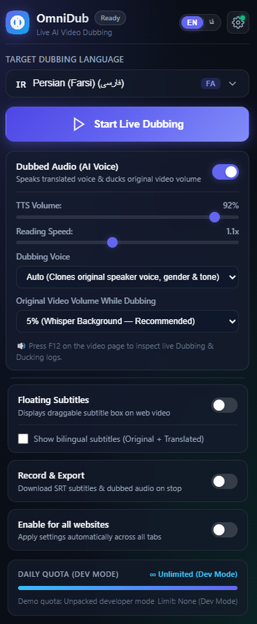
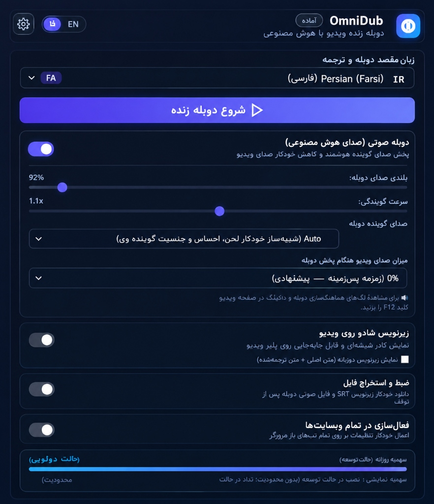

<p align="center">
  
</p>

<h1 align="center">OmniDub — Live AI Video Dubbing & Subtitles</h1>

<p align="center">
  <strong>Real-time AI dubbing, smart audio ducking, and bilingual subtitles for web videos powered by Google Gemini.</strong>
</p>

<p align="center">
  <a href="README.md"><strong>🇺🇸 English</strong></a> •
  <a href="README.fa.md"><strong>🇮🇷 فارسی (Persian)</strong></a>
</p>

<p align="center">
  
  
  
  
  
</p>

---

## 🌟 Overview

**OmniDub** is a high-performance Google Chrome extension (Manifest V3) that brings **live AI voice dubbing** and **bilingual floating subtitles** to any web video player (YouTube, Coursera, Udemy, Vimeo, edX, podcasts, and more).

Using the **Google Gemini API** (`gemini-2.5-flash` and Gemini Live real-time audio streams), OmniDub listens to tab audio, translates spoken content on the fly, speaks the translation with natural studio neural voices, and automatically ducks original video volume for a cinematic listening experience.

---

## 📸 Screenshots & UI Preview

### 🇺🇸 English Interface (LTR)
<p align="center">
  
</p>

<p align="center">
  <em>Default English control panel with studio neural voices, ducking controls, and real-time settings.</em>
</p>

<br />

### 🇮🇷 Persian Interface / رابط کاربری فارسی (RTL)
<p align="center">
  
</p>

<p align="center">
  <em>Full native Persian (RTL) localization with instant one-click toggle in the header.</em>
</p>

---

## 🚀 Key Features

- 🎙️ **Real-Time Live AI Dubbing**: Streams tab audio through an isolated Web Audio pipeline and translates speech with ultra-low latency.
- 🌍 **50+ Languages Supported**: Searchable language selector with country flags, ISO codes, and native script names (Persian / فارسی, Spanish, French, German, Arabic, Turkish, Japanese, Korean, and more).
- 🔊 **Smart Video Audio Ducking**: Automatically lowers the original video audio to 5% (customizable down to 0% mute or 15%/25%) while the AI is speaking, smoothly fading back to normal when silent.
- ✨ **Studio Neural Voices & Voice Match**: Choose from expressively tuned neural voices (Aoede, Puck, Kore, Fenrir, Charon, etc.) or enable **Auto Voice Match** to automatically adapt tone, gender, and cadence.
- 💬 **Floating Draggable Subtitles**: High-contrast, movable glassmorphic subtitle box rendered directly over any HTML5 video player. Supports bilingual mode (original transcript + translation side-by-side).
- 💾 **Record & Export**: Automatically saves and downloads timestamped `.srt` subtitle files and dubbed audio sessions.
- 🌐 **Instant Bilingual UI**: Seamlessly switch between English (LTR) and Persian (RTL) interface with full localization.
- 🔒 **100% Client-Side & Private**: Your API keys and data remain securely stored inside your browser (`chrome.storage.local`). Direct communication with Google's API—no middleman proxies or tracking.

---

## 📥 Installation & Quick Start

### Method 1: Download Pre-built Release (Recommended for Users)

1. Go to the [**Releases**](https://github.com/AM68JSU/OmniDub/releases) section of this repository.
2. Download the latest `OmniDub-v1.0.0.zip` package.
3. Extract the ZIP file into a permanent folder on your computer (e.g. `C:\Extensions\OmniDub` or `~/OmniDub`).
4. Open Google Chrome and enter `chrome://extensions/` in the address bar.
5. In the top-right corner, switch **Developer mode** to **ON**.
6. Click the **Load unpacked** button in the top-left corner.
7. Select the unzipped folder.
8. Pin the **OmniDub** icon to your Chrome toolbar for quick access!

---

### Method 2: Install from Source (For Developers)

```bash
# 1. Clone the repository
git clone https://github.com/AM68JSU/OmniDub.git

# 2. Navigate to directory
cd OmniDub

# 3. Open Chrome Extensions
# Go to chrome://extensions/ -> Enable "Developer mode" -> "Load unpacked" -> Select the OmniDub folder
```

---

## 🔑 Getting Your Google Gemini API Key

OmniDub connects directly to the official Google Gemini API:

1. Visit [**Google AI Studio**](https://aistudio.google.com/app/apikey).
2. Sign in with your Google Account.
3. Click **Create API key** (free tier is available with generous daily quotas).
4. Copy your API key.
5. In Chrome, click the **OmniDub** icon, click the **⚙️ Settings** icon in the header, paste your key, and click **Save Settings**.
6. Click **Test Connection** to verify your setup.

> [!TIP]
> Users in restricted geographic regions can use a standard VPN with access to Google AI Studio endpoints.

---

## 💡 How to Use

1. **Open any video site** (e.g. [YouTube](https://www.youtube.com), [Coursera](https://www.coursera.org), [Udemy](https://www.udemy.com)).
2. **Start playing the video**.
3. Click the **OmniDub** extension icon from your browser toolbar.
4. **Choose your Target Dubbing Language** from the dropdown (e.g., *Persian (Farsi)*).
5. Configure your preferences:
   - **TTS Volume & Speed**: Adjust speech loudness and cadence.
   - **Dubbing Voice**: Pick female, male, or Auto voice cloning.
   - **Original Video Ducking**: Set how much background audio to retain (default: 5% whisper).
   - **Floating Subtitles**: Toggle on/off or enable bilingual subtitles.
6. Click the big blue button: **▶ Start Live Dubbing**.
7. Sit back and watch the video dubbed live in your language with real-time subtitles!
8. Click **⏹ Stop Live Dubbing** when you finish. If *Record & Export* is enabled, your `.srt` file will download automatically.

---

## 🏗️ Architecture & Codebase

```text
OmniDub/
├── manifest.json                 # Chrome Manifest V3 configuration
├── CHROMEWEBSTORE.md             # Chrome Web Store submission & permissions doc
├── README.md                     # Main English documentation
├── README.fa.md                  # Persian documentation (راهنمای فارسی)
├── LICENSE                       # MIT License
├── icons/                        # Extension icons (16x16, 48x48, 128x128)
├── popup/                        # User interface panel
│   ├── popup.html                # Semantic UI with glassmorphism styling
│   ├── popup.css                 # Dark theme, RTL/LTR styles, animations
│   └── popup.js                  # UI controllers, language filtering, API modal
├── background/                   # Background Service Worker
│   └── service_worker.js         # TabCapture coordinator, offscreen lifecycle, audio ducking
├── offscreen/                    # Isolated Web Audio stream processing
│   ├── offscreen.html
│   ├── offscreen.js              # Audio slicing, 16kHz WAV encoding, stream manager
│   └── audio_processor.js        # AudioWorklet / buffer processor
├── content_scripts/              # Video page injection
│   ├── subtitle_overlay.css      # Floating subtitle overlay styles
│   └── subtitle_overlay.js       # In-page draggable container & volume ducking
├── services/                     # Business logic
│   ├── gemini_api.js             # Google Gemini REST client with structured JSON schema
│   ├── gemini_live_client.js     # Real-time WebSocket streaming client
│   ├── tts_engine.js             # Speech synthesis queue & ducking coordinator
│   ├── i18n.js                   # Internationalization engine (EN / FA)
│   ├── language_list.js          # 50+ languages with ISO & BCP-47 codes
│   └── quota_manager.js          # Unlimited usage engine (no session caps)
└── utils/                        # Helpers
    ├── audio_recorder.js         # Live session recorder & WAV exporter
    └── srt_generator.js          # SubRip (.srt) subtitle formatter
```

---

## 📦 Building & Packaging

To generate a clean production ZIP archive for Chrome Web Store or GitHub Releases:

```powershell
# Run the included packaging script
.\package-extension.ps1
```

This creates an optimized `OmniDub-v<version>.zip` ready for distribution.

---

## 🔒 Security & Privacy

- **No Remote Servers**: OmniDub operates 100% locally within your browser.
- **Direct Google API**: All audio chunks and requests are transmitted directly between your browser and `https://generativelanguage.googleapis.com` via secure HTTPS/WSS.
- **Local Storage**: Your API Key and preferences are stored exclusively on your device using Chrome's encrypted storage (`chrome.storage.local`).
- **No telemetry, tracking, or advertisements**.

---

## ❓ Frequently Asked Questions (FAQ)

<details>
<summary><strong>Q: Does OmniDub require a paid subscription?</strong></summary>
No. OmniDub is open-source and free. You use your own Google Gemini API key from Google AI Studio, which provides a free tier suitable for personal use.
</details>

<details>
<summary><strong>Q: Why does the video audio duck down when dubbing starts?</strong></summary>
This is an intentional feature called <em>Audio Ducking</em>. It lowers the original foreign dialogue down to 5% so you can clearly understand the translated voice. You can adjust this level to 0% (full mute), 15%, or 25% in the popup.
</details>

<details>
<summary><strong>Q: I live in Iran or a region where Google AI Studio is blocked. How can I use it?</strong></summary>
Enable your VPN before starting dubbing so your browser can reach Google's `generativelanguage.googleapis.com` endpoint. Use the "Test Connection" button in OmniDub settings to verify connectivity.
</details>

<details>
<summary><strong>Q: Which websites are supported?</strong></summary>
Any website that plays HTML5 video! Tested thoroughly on YouTube, Coursera, Udemy, Vimeo, Khan Academy, Twitch, and direct MP4 streams.
</details>

---

## 🤝 Contributing

Contributions, issues, and feature requests are welcome!  
Feel free to check the [issues page](https://github.com/AM68JSU/OmniDub/issues) or read [CONTRIBUTING.md](CONTRIBUTING.md).

---

## 📄 License

This project is licensed under the **MIT License** — see the [LICENSE](LICENSE) file for details.

<p align="center">
  Made with ❤️ for global knowledge sharing and accessibility.
</p>

